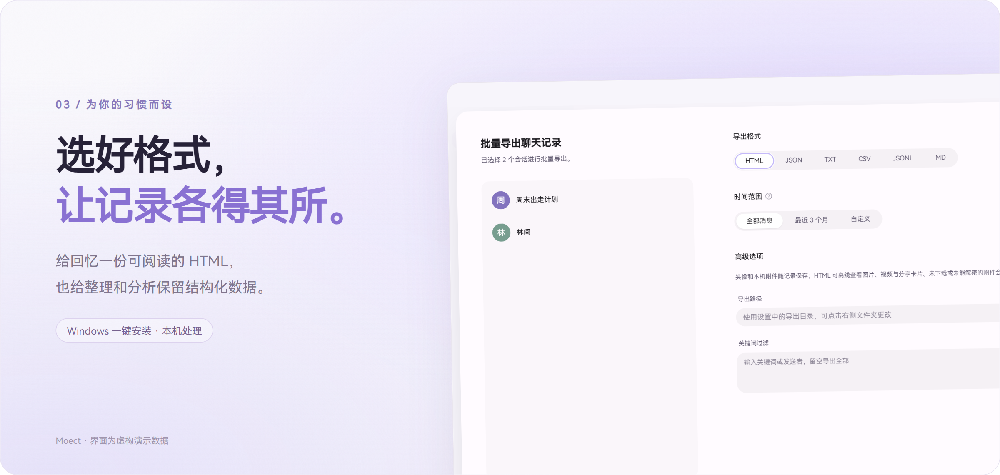

[](https://github.com/mofan6/Moect/releases/latest)

**Moect 是一个在 Windows 上读取、整理与导出微信聊天记录的桌面工具。**

把好友和群聊的记录留在自己的电脑里，随可用的头像、图片、视频和表情一起归档。导出的 HTML 打开就是聊天界面，可以搜索、按时间筛选，也可以展开合并转发。

紫色主题、鸿蒙字体，以及熟悉的会话与任务布局。一次选择一个会话，或把多个会话一起保存下来。

**[下载一键安装包](https://github.com/mofan6/Moect/releases/latest/download/Moect-1.1.0-Setup-x64.exe)** · **[使用指南](docs/usage.md)** · **[更新记录](CHANGELOG.md)** · **[反馈问题](https://github.com/mofan6/Moect/issues)**

[](https://github.com/mofan6/Moect/releases/latest)
[](https://github.com/mofan6/Moect/releases)
[](docs/usage.md)
[](LICENSE)

## 特性




| 你想做的事 | Moect 的方式 |
| --- | --- |
| 保存好友或群聊 | 点击会话预览，单独或批量导出 |
| 离线阅读 | HTML 对话气泡、头像、图片、GIF、音视频与分享卡片 |
| 找到某段记录 | 按发送者或正文搜索，按北京时间选择起止时间 |
| 保留转发和引用 | 引用回复、可展开的合并转发、独立转发记录页 |
| 整理和分析 | HTML、JSON、JSONL、TXT、CSV、Markdown 六种格式 |
| 管理导出任务 | 显示会话名称，打开文件或目录，删除任务记录 |

媒体能否保存取决于本地缓存、可用凭据及原始文件。没有取得的附件会显示具体状态；链接、小程序与转账卡片保留可用信息，不保证还原远端已失效的内容。卡片样式更新需要重新导出。

## 快速开始

1. 下载 [Moect 一键安装包](https://github.com/mofan6/Moect/releases/latest)，双击后点击“安装”。安装器会创建桌面和开始菜单入口；缺少 WebView2 时会自动准备运行环境，此时需要联网。
2. 打开并登录电脑微信，然后启动 Moect，点击“连接微信”。也可以打开已有解密备份，或先体验虚构的演示数据。
3. 点击会话查看记录，选择导出格式与时间范围，创建任务。
4. 导出完成后，在任务页面直接打开文件。HTML 打开即进入对话，批量导出可在顶部切换会话。

完整保留导出文件夹里的 HTML、消息分片和资源目录，才能在离线电脑上继续查看媒体。

## 运行环境与数据

- Windows 10 1809 或更新版本、Windows 11，x64；需要 Microsoft Edge WebView2 Runtime。
- 面向 Windows 微信 4.x。微信版本更新可能影响适配，当前不承诺覆盖所有 4.x 版本。
- 聊天数据库与消息解析在本机完成。按需访问媒体及头像来源，项目没有接收聊天记录的服务器。
- 默认导出目录：`文档\Moect\exports`，可在设置中修改。升级沿用原有配置、任务、快照与媒体密钥缓存，卸载程序保留这些用户数据。

图片中的账号、会话、消息和山野插画均为虚构演示内容。

## 开发与构建

代码采用 Python 3.11、pywebview / WebView2、React / TypeScript。安装版已经包含 Python 和前端，无需另装开发环境。

```powershell
python -m venv .venv
.\.venv\Scripts\Activate.ps1
pip install -r requirements.txt
npm ci --prefix frontend
npm run build --prefix frontend
Copy-Item ui/icon.svg ui-qce/icon.svg
python build.py
# 安装 Inno Setup 6.5+ 后生成一键安装包
.\installer\build.ps1 -OutputDirectory .\release
```

详细说明见 [构建指南](docs/build.md)，宣传图的可重复生成脚本在 `docs/tools/render_assets.py`。

## 致谢与许可证

Moect 基于 [WeChatMsg](https://github.com/LC044/WeChatMsg)、[WeChatMsg 4.x 适配版](https://github.com/chenanhan230-del/WeChatMsg-4x) 的相关工作，直接复用和改造了 [QQ Chat Exporter](https://github.com/shuakami/qq-chat-exporter) 的界面组件及部分导出设计。感谢原作者及贡献者。

本项目按 [GPL-3.0](LICENSE) 发布。原始著作权与依赖许可证见 [THIRD_PARTY_NOTICES.md](THIRD_PARTY_NOTICES.md) 和 [THIRD_PARTY_LICENSES](THIRD_PARTY_LICENSES)。Moect 是独立的社区项目，与微信、腾讯及上述项目不存在官方隶属关系。
